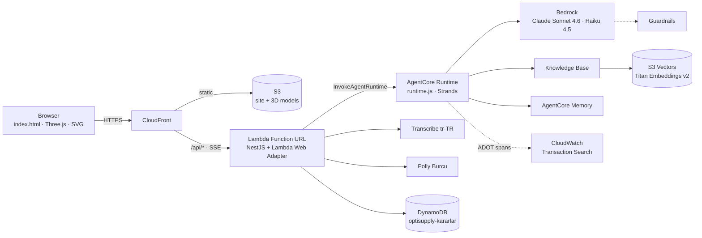

# Design Document

## Overview

OptiSupply runs a deterministic hourly twin of the Pınar Et red-meat plant in the browser, and lets eight Strands agents on Amazon Bedrock respond to shocks, customer orders and user questions. Two design rules shape the system:

1. **Numbers come from the twin, not the model.** The browser twin (`frontend/index.html`) and the backend twin (`backend/src/twin/sim.ts`) contain the same functions. Agents read state and run projections only through tools backed by the backend twin. Chart data is also computed by the twin.
2. **Every managed service is optional.** Runtime, Memory, Knowledge Base, Guardrail, Decision Log and voice can each be missing. The app falls back locally, and the UI keeps working with scripted agents if the backend is unreachable.

## Architecture



### Request flows

| Flow | Path |
|---|---|
| Page load | Browser ← CloudFront ← S3 (`index.html`, `config.js`, `models/*.glb`); `GET /api/health?deep=1`; `POST /api/agents/warm` |
| Shock negotiation | `POST /api/agents/negotiate` (snapshot + shock) → Lambda → Runtime `negotiate` → Strands Graph → SSE events back to the browser |
| Chat | `POST /api/assistant/stream` → Runtime `ask_stream` → assistant agent → SSE `tool`, `delta`, `reset`, `chart`, `done` |
| Voice | Web Audio VAD → `POST /api/voice/transcribe` → chat stream → `POST /api/voice/speak` per sentence (MP3 + speech marks) |
| Decisions | `POST /api/decisions` → DynamoDB; rejections → `POST /api/memory/:session` → AgentCore Memory |
| Fallbacks | Runtime error before the first event → in-process agents in Lambda; backend unreachable → scripted agents and rule-based answers in the browser |

## Repository Layout

```
OptiSupply-Altyapi.gif                  architecture animation
frontend/
  index.html                            application (UI, browser twin, 3D, chat, voice)
  config.js                             optional API base URL
  models/{cow,worker,truck}.glb         Quaternius CC0 models + LISANS.txt
backend/
  src/main.ts                           NestJS bootstrap (static frontend locally, CORS, 5 MB JSON)
  src/runtime.ts                        AgentCore Runtime entry (BedrockAgentCoreApp)
  src/app.module.ts
  src/api/agents.controller.ts          health, negotiate, warm, explain, assistant, voice, memory
  src/api/agents.service.ts             routing to Runtime or in-process agents, Polly
  src/api/transcribe.ts                 Transcribe streaming (PCM 16 kHz, tr-TR)
  src/decisions/                        DynamoDB decision log (local fallback)
  src/memory/                           ConstraintMemory: AgentCore Memory + local
  src/twin/sim.ts                       backend twin (Twin class, constants, shocks, actions)
  src/agents/config.ts                  environment configuration
  src/agents/model.ts                   BedrockModel factories (strong, fast, signal, guarded)
  src/agents/tools.ts                   twin tools
  src/agents/roster.ts                  agent definitions, lineups, output schemas
  src/agents/negotiation.ts             Strands Graph negotiation + SSE events
  src/agents/assistant.ts               assistant (stream / once), explainer
  src/agents/knowledge.ts               Knowledge Base retrieve tool
  src/agents/charts.ts                  chart tool and chart builder
  src/agents/runtime-client.ts          InvokeAgentRuntime client (SSE + JSON)
infra/
  deploy.sh                             S3, CloudFront, Lambda, Runtime, DynamoDB, IAM
  guardrail.sh                          Bedrock guardrail + version
  kb/build_docs.py, kb/setup_kb.sh      Knowledge Base documents (needs the source HTML files in the root), S3 Vectors, ingestion
  kb/docs/                              generated Knowledge Base documents (committed)
README.md, DEPLOY.md, TEKNOLOJILER.md
```

## Components and Interfaces

### 1. Twin (browser and backend)

- State per plan: `stock`, `pm` (price multipliers), `why`, `win` (24-hour window), `c` (cumulative), `last` (last hour result), `kpi`, `od` (order fulfilment), `fz` (frozen mass).
- `demand(sim, h)` = base demand × time-of-day curve × shock multipliers × what-if factor; for the OptiSupply plan × `pm^-elasticity` (+18% with `campaign` on overstock); plus active customer orders.
- `choose()`: the Classic plan buys `min(cap, total × 1.08)`; the OptiSupply plan scans 25 carcass volumes between `0.6 × min(cap, total)` and `min(cap, 1.6 × total)` and maximizes `profit − 0.3·U·loss − 0.25·U·frozen`.
- `evalHour()`: carcass split by yield shares, external premium purchase up to `buyCap`, fresh orders first, delicatessen lines up to their target (meat × 1.33), premium surplus above 1.5 hours of demand frozen, quality loss, aging (1.5%), storage overflow, P&L.
- `reprice()`: the rules of Requirement 6 (`PRICE_RULE = {hot: 1.02, cool: 0.82}`), step 0.012, corridor 0.08 or 0.15.
- `stepSim()`: one hour, order fulfilment `served/demand × order rate`, rolling 24-hour KPIs.
- `project(shock, actions)`: 24 steps on a copy with and without the actions; live state is unchanged.
- Browser only: seeded RNG (`mkRng(47)`, `mkRng(99)`), sensors, HACCP, lots, alarms, warm-up, clock, automatic orders, 3D binding.

### 2. Agents (`backend/src/agents`)

| Agent | Role | Tools |
|---|---|---|
| OR Orkestratör | Chooses actions, rationale, decision | `hafizadaki_kisitlar`, `plani_projekte_et`, `ikiz_gostergeleri` |
| TA Talep | Demand signal | `talep_sinyali` |
| VE Karkas / Verim | Carcass coupling, objects to extra carcass | `karkas_verim`, `soguk_depo` |
| UK Ürün Karması | Routing surplus to lines | `hat_kapasitesi`, `karkas_verim` |
| FY Fiyat | Price corridor | `fiyat_durumu` |
| TE Tedarik | Supply capacity, alternative suppliers | `tedarik_durumu` |
| LO Lojistik | Cold store, transfers | `soguk_depo` |
| TI Ticari | Customers, channels, campaigns | `talep_sinyali`, `ikiz_gostergeleri` |

Lineups (wave 1 → wave 2 → OR):

| Shock | Wave 1 | Wave 2 |
|---|---|---|
| horeca | TA | TI, VE, FY, UK |
| kurban | TA, TE | LO, FY, UK |
| karantina | TE | VE, FY, UK |
| depo | LO | VE, FY, UK |

- Models: Orchestrator and assistant use `BEDROCK_MODEL_ID` (Claude Sonnet 4.6); specialists use `BEDROCK_FAST_MODEL_ID` (Claude Haiku 4.5). `BEDROCK_SIGNAL_MODEL_ID` and `VOICE_MODEL_ID` are optional overrides; Nova 2 Lite was evaluated and not adopted.
- Structured output (Zod): `SpecialistOut {mesaj, catisma, oneri[]}`, `OrchestratorOut {aksiyonlar[], gerekce, karar}`.
- `runNegotiation` emits `start`, `thinking`, `tool`, `say`, `plan`, `trace`, `error` and `done`. The plan always carries a server-side projection, and actions are filtered to the allowed set.
- The assistant tools are the twin tools plus `bilgi_bankasi` and `grafik_goster`. The prompt forbids preamble text before tool calls; the stream emits `reset` if a preamble still occurs.
- Chart kinds: `saatlik_kar`, `saatlik_atil`, `plan_karsilastirma`, `parca_fiyat`, `parca_stok`, `parca_talep`, `hat_doluluk`, `siparisler` (`ChartSpec {type: bar|hbar|line|table, title, unit, labels, series, columns, rows, note}`).

### 3. API (NestJS) and Runtime

| Endpoint | Purpose |
|---|---|
| `GET /api/health?deep=1` | Configuration and a Bedrock ping |
| `POST /api/agents/negotiate` | SSE negotiation (3 s heartbeat) |
| `POST /api/agents/warm` | Start the Runtime session |
| `POST /api/agents/explain` | "Neden bu karar?" commentary |
| `POST /api/assistant/stream` / `ask` | Streaming / single-shot assistant |
| `POST /api/voice/transcribe` | `{audio: base64 PCM16, sampleRate}` → text |
| `POST /api/voice/speak` | `{text, marks?}` → MP3, or JSON with base64 audio and word marks |
| `GET/POST /api/memory/:session` | Rejection memory |
| `GET/POST /api/decisions[/:session]` | Decision log |

Runtime (`runtime.ts`): `BedrockAgentCoreApp` on port 8080. The request schema has `action ∈ {negotiate, ask, ask_stream, explain, warm}`. Streaming actions return async generators; the others return JSON. `runtime-client.ts` sends `accept: text/event-stream` for streaming actions and uses `runtimeSessionId = optisupply-<session>` padded to at least 33 characters.

### 4. Memory, Knowledge Base, Guardrail, Decision Log

- **Memory:** `CreateEventCommand` with a USER conversational payload. Metadata keys `flag` and `shock` are ASCII only; the Turkish reason is inside the text. Records are read with `ListEvents`, and long-term records are retrieved from namespace `/kisitlar/{actorId}`. The actor ID is configurable (`AGENTCORE_ACTOR_ID`), so memory can be reset by changing it.
- **Knowledge Base:** 12 Markdown documents (guide, HACCP, approvals and actions, report summary, open orders and stock, six monthly family reports, model assumptions). Index: S3 Vectors, 1024 dimensions, cosine, non-filterable `AMAZON_BEDROCK_TEXT` and `AMAZON_BEDROCK_METADATA`. Embeddings: Titan v2 (Cohere required a Marketplace subscription). Chunking: 300 tokens with 15% overlap.
- **Guardrail:** STANDARD tier with cross-region profile `us.guardrail.v1:0`.
  - **Content filters:** hate, insults, sexual and misconduct HIGH; violence MEDIUM; prompt attack HIGH on input.
  - **Denied topic:** "Siyaset". An investment topic was removed because it blocked profitability questions.
  - **PII:** e-mail and phone are anonymized; regexes `TC_KIMLIK` and `TR_TELEFON`.
  - **Runtime settings:** `guardLatestUserMessage` and `streamProcessingMode: async`, so the answer is not held until completion. The current version is 4.
- **Decision Log:** DynamoDB, key `sessionId` + `ts`, 30-day TTL, record types `siparis`, `oneri`, `onay` and `red`.

### 5. Frontend

- **Bridge:** `snapshot()` serializes the slim plan state together with `env`. The `negotiate()` SSE consumer queues messages at a readable pace and pauses the clock while agents negotiate. `answer()` streams chat; `answerOnce()` and `answerRule()` are fallbacks. Responses render through `chatChart()`.
- **Voice (`VOICE` module):** ScriptProcessor capture with an adaptive noise floor.
  - **Thresholds:** start of speech after 140 ms over `max(0.012, floor × 3.2)`; end after 1 s of silence; maximum utterance 20 s.
  - **Barge-in:** over `max(0.05, floor × 8)` for 260 ms, keeping 900 ms of pre-roll.
  - **Output:** `speakStream()` splits sentences, prefetches Polly audio, plays the sentences in order and reveals text by speech marks (UTF-8 byte offsets).
- **3D:**
  - **Models:** GLTF models are cloned with SkeletonUtils, height-normalized and rotated with `FACE` to face +x. Truck wheels are re-pivoted to their own centers and rotated around world z.
  - **Workers:** nine walk paths with station loads.
  - **Camera:** presets `genel`, `tedarik`, `depo`, `hat`, `kabul`, `kesim`, `depoIc`, `hatYakin`, `rampa`; the field of view adapts to the aspect ratio.
  - **Sound:** a synthesized Web Audio "moo".
- **Layout:**
  - **Desktop:** at ≥1100 px, `.main` is a four-column grid (scene 3 columns, console 1); the console and scene share the same height.
  - **Narrow screens:** compact rules at ≤760 px and ≤420 px.
  - **Chat:** the bottom chat bar and a light modal, side-by-side text and charts.
- **Demo:** 12 steps with `narrate()` off by default.

## Data Models

```ts
// Snapshot (browser → backend)
{ env: { hour, shocks, approved, memory[{flag,q,at}], rejPlan[], orders[], orderSeq, llmPlan? },
  simA: { policy:'ajan', stock, pm, why, win, c, last, kpi, fz, od },
  simK: { policy:'klasik', … }, WI: { price, demand, store } }

// Customer order
{ id:'S-1001', cust, ch:'ch_horeca', part:'ant', kg, h0, due, doneA?, doneK?, late? }

// Negotiation event (SSE)
start | thinking{id} | tool{id,tool} | say{id,text,cls?,label?,oneri?} |
plan{shock,actions,why,decision,source,projection{with,without}} | trace{steps,totalMs} | error | done

// Assistant stream event (SSE)
tool{name} | reset | delta{text} | chart{chart: ChartSpec} | done{answer,ms,firstTokenMs,guardrail?,host?}

// Decision record (DynamoDB)
{ sessionId, ts, type:'siparis'|'oneri'|'onay'|'red', shock?, shockTitle?, actions?, flag?, reason?, by?, source?, simHour?, simClock?, projection?, ttl }
```

## Configuration

| Variable | Meaning |
|---|---|
| `AWS_REGION` | `us-east-1` |
| `BEDROCK_MODEL_ID` / `BEDROCK_FAST_MODEL_ID` | Orchestrator and assistant / specialists |
| `BEDROCK_SIGNAL_MODEL_ID`, `VOICE_MODEL_ID` | Optional model overrides |
| `NEGOTIATION_TIMEOUT_MS` | Graph timeout (28,000) |
| `AGENTCORE_MEMORY_ID`, `AGENTCORE_MEMORY_NAMESPACE`, `AGENTCORE_ACTOR_ID` | Memory |
| `KNOWLEDGE_BASE_ID` | Knowledge Base |
| `GUARDRAIL_ID`, `GUARDRAIL_VERSION` | Guardrail |
| `DYNAMODB_TABLE` | Decision log |
| `TRANSCRIBE_VOCABULARY`, `POLLY_VOICE` | Voice |
| `AGENT_RUNTIME_ARN` | Set on Lambda by `deploy.sh`; enables Runtime routing |
| `PORT`, `CORS_ORIGINS`, `FRONTEND_DIR` | Local server |

The Runtime additionally sets `AGENT_OBSERVABILITY_ENABLED=true`, `OTEL_SERVICE_NAME=optisupply_ajanlar`, `OTEL_LOGS_EXPORTER=none`, `OTEL_METRICS_EXPORTER=none` and `NODE_OPTIONS=--require @aws/aws-distro-opentelemetry-node-autoinstrumentation/register`.

## Deployment

- **S3 + CloudFront:**
  - **Origins:** the private site bucket through OAC; the Function URL as a custom origin with a 60 s read timeout.
  - **`/api/*` behavior:** CachingDisabled with the AllViewerExceptHostHeader origin request policy.
  - **Models:** `models/*.glb` are served as `model/gltf-binary`.
- **Lambda `optisupply-api`:**
  - **Runtime:** Node 22, arm64, 1,536 MB, 120 s timeout, Lambda Web Adapter layer (`AWS_LWA_INVOKE_MODE=response_stream`).
  - **Function URL:** RESPONSE_STREAM with auth NONE; `lambda:InvokeFunction` is allowed only with `InvokedViaFunctionUrl`.
- **AgentCore Runtime `optisupply_ajanlar`:** NODE_22 code zip, entry point `dist/runtime.js`, public network.
  - **Role permissions:** allow-listed Bedrock models, Memory, Knowledge Base, guardrail, X-Ray/OTLP and logs.
- **Observability:** CloudWatch Transaction Search is enabled (the trace segment destination is CloudWatch Logs).

## Correctness Properties

1. **Parity:** for the same snapshot, the browser `project()` and the backend `Twin.project()` give identical 24-hour profit, wasted cuts, fulfilment and rejected tonnage. Verified end to end, with and without customer orders.
2. **Determinism:** two page loads show identical KPIs at the same elapsed time.
3. **Allowed actions:** the Orchestrator's actions are a subset of the shock's actions minus remembered rejections; an empty result falls back to all allowed actions with `source: fallback`.
4. **Price corridor:** `1 − band ≤ pm ≤ 1 + band` after every hour; Classic prices stay at 1.
5. **Projection isolation:** `project()` restores `env` and `simA` from copies.
6. **Order accounting:** delivered mass per order never exceeds the order mass for either plan.
7. **Fallback continuity:** any failure in a managed integration leaves the UI usable (scripted agents, rule-based answers, browser speech recognition).

## Error Handling

- **SSE:** every stream ends with `done`, or with `error` followed by the end of the stream. The browser has timeouts (32 s for negotiation, 45 s for chat) and falls back by step.
- **Runtime errors:** before the first event they trigger in-process execution; after it they are surfaced as `error`.
- **Memory and Decision Log:** write failures fall back to local storage and are logged as warnings.
- **Guardrail:** an intervention returns the configured Turkish message with `guardrail: intervened`; the UI shows a guardrail note.

## Testing Strategy

**Unit tests** (`backend/test/twin.test.mjs`, `node:test`, offline, run with `npm test` after `npm run build`) cover determinism, the price corridors, the premium price rise under the HoReCa shock, projection isolation, allowed actions after rejections, the Classic purchasing formula, the carcass yield split, customer-order demand and delivery bounds, OptiSupply vs Classic KPIs, and chart builder output.

**End-to-end checks** were run with headless Chrome (Puppeteer) against the local server and the CloudFront URL during development:

- **Parity:** projection parity during a shock, with and without an active order.
- **Demo:** the 12-step run and the cold-store failure scenario (sensor alarm, lot hold).
- **Backend failure:** killing the backend mid-negotiation falls back correctly.
- **Chat and voice:**
  - **Streaming:** timing of the first token and of chart arrival.
  - **Voice:** an injected audio stream for end-of-speech detection and barge-in.
  - **Guardrail:** checks for false positives.
- **Layout:** mobile overflow at 390 px on every view; the desktop grid alignment is measured in pixels.
- **AWS checks with the CLI:**
  - **Knowledge Base:** retrieval of Turkish queries.
  - **Memory:** retrieval of the long-term records.
  - **Observability:** span counts in `aws/spans`.

The end-to-end scripts were development checks and are not part of the repository; property-based tests and a CI pipeline are out of scope for this phase.
