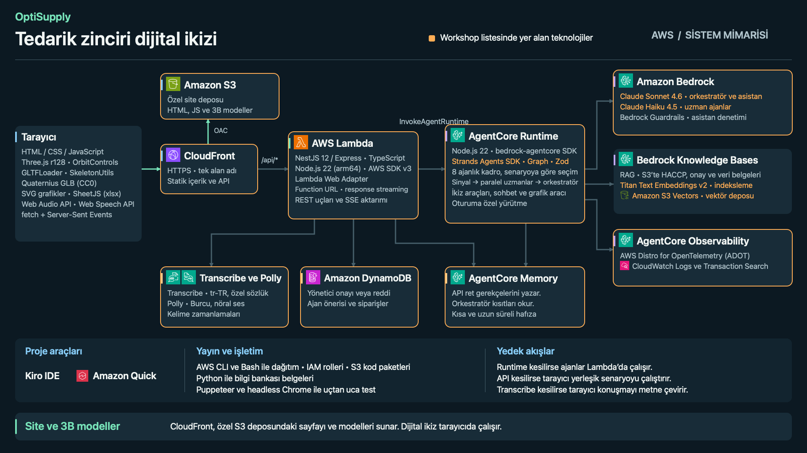

# OptiSupply · Pınar Et tedarik dijital ikizi

Kırmızı et tedarik zinciri için dijital ikiz. Aynı siparişlerle iki plan yan yana çalışır: yapay zekâ ajanlarının planı (OptiSupply) ve bugünkü klasik plan.

AWS + Deloitte "Agentic AI in Supply Chain" hackathonu için geliştirildi.



**Öne çıkanlar**
- 3B canlı fabrika ikizi (Three.js): veriye bağlı animasyon, müşteri siparişleri, şok senaryoları
- 8 Strands ajanı Amazon Bedrock'ta müzakere eder; plan insan onayına gelir, reddedilen gerekçe AgentCore Memory'de saklanır
- Akışlı (streaming) sohbet asistanı: grafik ve tablo çizer, bilgi bankasından kaynak gösterir, Guardrails ile korunur
- Karşılıklı sesli sohbet: Amazon Transcribe (Türkçe) + Amazon Polly, söze girme destekli
- Mobil uyumlu arayüz, 12 adımlı demo senaryosu

## Mimari

```
Tarayıcı ──▶ CloudFront ──┬──▶ S3 (frontend/index.html · 3B ikiz + simülasyon)
                          └─ /api/* ──▶ Lambda (Nest.js API · Web Adapter · SSE akışı)
                                          │  InvokeAgentRuntime
                                          ▼
                             Amazon Bedrock AgentCore Runtime (Node 22)
                               Strands Agents · 8 ajan · Graph müzakeresi
                                 ├─ Amazon Bedrock: Claude Sonnet 4.6 (orkestratör, asistan) · Claude Haiku 4.5 (uzmanlar)
                                 ├─ AgentCore Memory: reddedilen aksiyonlar ve gerekçeleri (semantik uzun süreli hafıza)
                                 ├─ Bedrock Knowledge Base (S3 Vectors · Titan Embeddings v2): rehber, HACCP, onay matrisi, veri raporu
                                 ├─ Guardrails for Amazon Bedrock: sohbet asistanı (prompt saldırısı, konu dışı, kişisel veri)
                                 └─ AgentCore Observability: ADOT → CloudWatch Transaction Search (graph, ajan, model, araç span'leri)
                          Lambda ayrıca: Amazon Transcribe (tr-TR, özel sözlük) · Amazon Polly (Burcu, kelime zamanlamalı)
                                         Amazon DynamoDB (karar kaydı: öneri / onay / red)
```

| Uç nokta | İş |
|---|---|
| `POST /api/agents/negotiate` | Şok müzakeresi (SSE): sinyal ajanları → uzmanlar (paralel) → Orkestratör |
| `POST /api/assistant/stream` | Akışlı sohbet asistanı (SSE): ikiz araçları, Knowledge Base, grafik aracı |
| `POST /api/assistant/ask` | Tek seferlik asistan yanıtı (yedek) |
| `POST /api/agents/explain` | "Neden bu karar?" yorumu |
| `POST /api/agents/warm` | Oturumun AgentCore Runtime'ını önceden başlatır |
| `GET/POST /api/memory/:session` | AgentCore Memory |
| `POST /api/voice/speak` | Polly sesi (+ kelime zamanlamaları) |
| `POST /api/voice/transcribe` | Amazon Transcribe (16 kHz PCM → Türkçe metin) |
| `GET/POST /api/decisions` | DynamoDB karar kaydı |

- **Ajanlar (8):** Orkestratör, Talep, Karkas/Verim, Ürün Karması, Fiyat, Tedarik, Lojistik, Ticari. Her şokta uygun kadro bir Strands `Graph` olarak çalışır.
- **Rakamlar araçlardan gelir:** simülasyon çekirdeği `backend/src/twin/sim.ts`. Orkestratör `plani_projekte_et` aracıyla aday planları 24 saat ileri simüle eder; model rakam üretmez.
- **Bilgi bankası:** `infra/kb/build_docs.py` yalnızca proje HTML dosyalarındaki bilgiden belge üretir. Canlı rakamlar ikizden, kurallar ve geçmiş veri Knowledge Base'den gelir.
- **İnsan onayı:** Orkestratör yalnızca ikizin uygulayabildiği aksiyonlardan seçer. Reddedilen aksiyon AgentCore Memory'ye yazılır; aynı oturumda bir daha önerilmez, geçmiş oturumlardan öğrenilen kısıtlar Orkestratörün gerekçesine girer.
- **Modeller:** uzmanlar için Amazon Nova 2 Lite da denendi; hızlı ama sayı okuma hataları yaptığı için ajanlarda Claude Haiku 4.5 kullanılıyor (`BEDROCK_SIGNAL_MODEL_ID` ile açılabilir).
- **Yedekler:** AgentCore Runtime yanıt vermezse API ajanları kendi sürecinde çalıştırır; backend'e hiç ulaşılamazsa ekran yerleşik senaryoyla devam eder.

## AWS'ye kurulum

Ayrıntılı adımlar ve kaynak listesi: [DEPLOY.md](DEPLOY.md). Teknolojiler ve aralarındaki ilişki: [TEKNOLOJILER.md](TEKNOLOJILER.md).

```bash
infra/kb/setup_kb.sh        # Knowledge Base (S3 Vectors) + belge yükleme
infra/guardrail.sh          # Guardrail + yeni sürüm (backend/.env'e GUARDRAIL_ID/VERSION yazın)
infra/deploy.sh all         # S3 + CloudFront + Lambda + AgentCore Runtime
infra/deploy.sh backend     # yalnızca API
infra/deploy.sh runtime     # yalnızca ajanlar (AgentCore Runtime)
infra/deploy.sh frontend    # yalnızca ön yüz
```
Oluşan kaynak kimlikleri `infra/.state.env` dosyasına yazılır.

## Yerelde çalıştırma

```bash
cd backend
npm install
cp .env.example .env      # model kimlikleri ve AGENTCORE_MEMORY_ID
npm run build && npm start
# http://localhost:3100
```

Birim testleri (ağ gerekmez): `npm run build && npm test`

AWS kimlik bilgileri gerekir (`aws login`). Kontrol: `curl 'localhost:3100/api/health?deep=1'`.

Sesli soru: sohbet penceresindeki mikrofon düğmesi (Chrome, Türkçe). Yanıt Amazon Polly ile seslendirilir.

## Proje yapısı

```
frontend/       index.html (arayüz + tarayıcı ikizi + 3B + sohbet + ses), config.js, models/ (CC0 3B modeller)
backend/        NestJS API, AgentCore Runtime girişi, Strands ajanları, ikiz çekirdeği (src/twin/sim.ts), testler
infra/          deploy.sh, guardrail.sh, kb/ (bilgi bankası belgeleri ve kurulumu)
.kiro/specs/    gereksinimler, tasarım ve görevler
```

## Notlar

- Rakamlar Pınar Et verisinden türetilmiştir (2 katına ölçeklenmiş); fiyatlar ve maliyetler örnektir.
- Hackathon için sağlanan iki kaynak HTML dosyası (prototip ve rehber) bu repoda yer almaz; bilgi bankası belgeleri `infra/kb/docs/` altında hazırdır.
- 3B modeller: Quaternius, CC0 (`frontend/models/LISANS.txt`).

