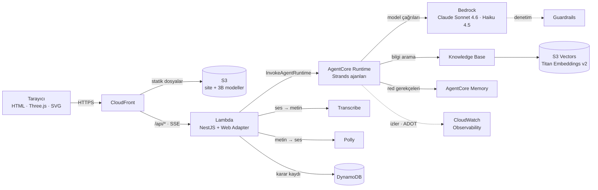

# OptiSupply · Kullanılan Teknolojiler

## Bileşenler arası ilişki

### Akışlar

1. **Sayfa açılışı:** Tarayıcı, CloudFront üzerinden S3'teki sayfayı ve 3B modelleri alır. Simülasyon (dijital ikiz) tarayıcıda çalışır. Sayfa açılırken `/api/health` ile Bedrock bağlantısını kontrol eder ve `/api/agents/warm` ile oturumun AgentCore Runtime örneğini önceden başlatır.
2. **Şok müzakeresi:**
   - **İstek:** Tarayıcı, ikizin anlık görüntüsünü `/api/agents/negotiate` adresine gönderir. Lambda bunu AgentCore Runtime'a iletir.
   - **Graph:** Runtime'da Strands Graph çalışır: sinyal ajanları → uzman ajanlar (paralel) → Orkestratör.
   - **Ajanların veri ve model erişimi:** Ajanlar rakamları backend'deki ikiz kopyasından (araçlarla) okur ve Bedrock'taki Claude modellerini çağırır. Orkestratör, hafızadaki redleri AgentCore Memory'den alır.
   - **Akış:** Mesajlar SSE ile Runtime → Lambda → CloudFront → tarayıcı zincirinden canlı akar.
3. **Onay ve red:**
   - **Karar kaydı:** Yöneticinin kararı, ajan önerisi ve siparişler `/api/decisions` ile DynamoDB'ye yazılır.
   - **Red gerekçesi:** AgentCore Memory'ye yazılır; Memory buradan uzun süreli kayıt çıkarır.
4. **Sohbet asistanı (`/api/assistant/stream`):**
   - **Model ve araçlar:** Runtime'daki asistan Claude Sonnet 4.6'yı Guardrails ile çağırır. İkiz araçlarını, Knowledge Base'i (S3 Vectors + Titan) ve grafik aracını kullanır.
   - **Akış:** Metin ve grafik verisi SSE ile parça parça gelir. Tarayıcı grafiği SVG olarak çizer.
5. **Sesli sohbet:**
   - **Dinleme:** Tarayıcı Web Audio ile kaydeder ve konuşmanın bittiğini algılar.
   - **Metne çevirme:** Kayıt `/api/voice/transcribe` ile Transcribe'a gider ve metne çevrilir.
   - **Yanıt:** Metin, sohbet asistanına (4. akış) gönderilir.
   - **Seslendirme:** Yanıt cümle cümle `/api/voice/speak` ile Polly'de seslendirilir. Kelime zamanlamaları metni sesle senkron gösterir.
6. **Gözlem:** Runtime'daki ADOT, Strands'in Graph, ajan, model ve araç adımlarını CloudWatch'a (AgentCore Observability) gönderir.
7. **Yedekler:**
   - **Runtime yanıt vermezse:** Lambda ajanları kendi sürecinde çalıştırır.
   - **Backend'e hiç ulaşılamazsa:** ekran yerleşik senaryoyla çalışmaya devam eder.
   - **Transcribe başarısız olursa:** tarayıcının konuşma tanıması devreye girer.

## Ön yüz (frontend)

| Teknoloji | Ne için |
|---|---|
| HTML / CSS / JavaScript (tek dosya) | Arayüz, simülasyon ve sayfalar |
| Three.js r128 | 3B fabrika sahnesi |
| GLTFLoader + SkeletonUtils | 3B modelleri (inek, işçi, kamyon) yükleme ve çoğaltma |
| Quaternius 3B modelleri (CC0) | Animasyonlu inek, işçi ve kamyon |
| SVG (elle çizim) | Sayfa grafikleri ve sohbet içi grafik/tablo |
| SheetJS (xlsx) | Excel'e aktarma |
| Web Audio API | Kayıt ve konuşma sonu algılama, inek sesi |
| Web Speech API | Mikrofon için yedek konuşma tanıma (Chrome) |
| Server-Sent Events (fetch akışı) | Ajan müzakeresinin ve sohbet yanıtının canlı akışı |

## Backend

| Teknoloji | Ne için |
|---|---|
| Node.js 22/24 + TypeScript | Sunucu dili ve çalışma ortamı |
| NestJS 12 | API katmanı (uç noktalar, servisler) |
| Strands Agents (TypeScript SDK) | 8 ajan, araçlar ve Graph ile çoklu ajan müzakeresi |
| bedrock-agentcore SDK | Ajanları AgentCore Runtime'da çalıştıran sunucu |
| AWS SDK v3 | Bedrock, AgentCore, Polly, Transcribe ve DynamoDB çağrıları |
| Zod | Ajan araçlarının ve çıktılarının şeması |
| AWS Distro for OpenTelemetry (ADOT) | Ajan izlerini CloudWatch'a gönderme |

## Yapay zekâ (Amazon Bedrock)

| Teknoloji | Ne için |
|---|---|
| Claude Sonnet 4.6 | Orkestratör ve sohbet asistanı |
| Claude Haiku 4.5 | Uzman ajanlar (talep, verim, fiyat vb.) |
| Amazon Titan Text Embeddings v2 | Bilgi bankası için Türkçe embedding |
| Bedrock Knowledge Bases | HACCP, onay matrisi, veri raporu gibi belgelerde arama (RAG) |
| Guardrails for Amazon Bedrock | Prompt saldırısı ve siyaset engeli, kişisel veri maskeleme |

## Amazon Bedrock AgentCore

| Servis | Ne için |
|---|---|
| AgentCore Runtime | Ajanları oturum izolasyonlu, sunucusuz çalıştırma |
| AgentCore Memory | Reddedilen kararları hatırlama (kısa ve uzun süreli hafıza) |
| AgentCore Observability | Ajan, model ve araç adımlarını CloudWatch'ta izleme |

## Ses

| Servis | Ne için |
|---|---|
| Amazon Transcribe (tr-TR, özel sözlük) | Konuşmayı metne çevirme |
| Amazon Polly (Burcu, nöral) | Yanıtı seslendirme; kelime zamanlamalarıyla metni sesle senkron gösterme |

## Veri ve altyapı (AWS)

| Servis | Ne için |
|---|---|
| AWS Lambda + Lambda Web Adapter | NestJS API'yi sunucusuz, akış destekli çalıştırma |
| Lambda Function URL (response streaming) | SSE akışı (API Gateway'in ~29 sn zaman aşımı yok) |
| Amazon CloudFront | Siteyi ve `/api` isteklerini tek adresten sunma |
| Amazon S3 | Ön yüz dosyaları, 3B modeller, kod paketleri, bilgi bankası belgeleri |
| Amazon S3 Vectors | Bilgi bankasının vektör deposu |
| Amazon DynamoDB | Karar kaydı (sipariş, öneri, onay, red) |
| AWS IAM | Servisler için en az yetkili roller |
| Amazon CloudWatch (Logs, Transaction Search) | Loglar ve ajan izleri |

## Geliştirme ve kurulum

| Araç | Ne için |
|---|---|
| AWS CLI + Bash betikleri (`infra/`) | Tek komutla tekrarlanabilir kurulum |
| Python | Bilgi bankası belgelerini HTML'den üretme |
| Puppeteer + headless Chrome | Uçtan uca tarayıcı testleri ve ekran görüntüleri |
